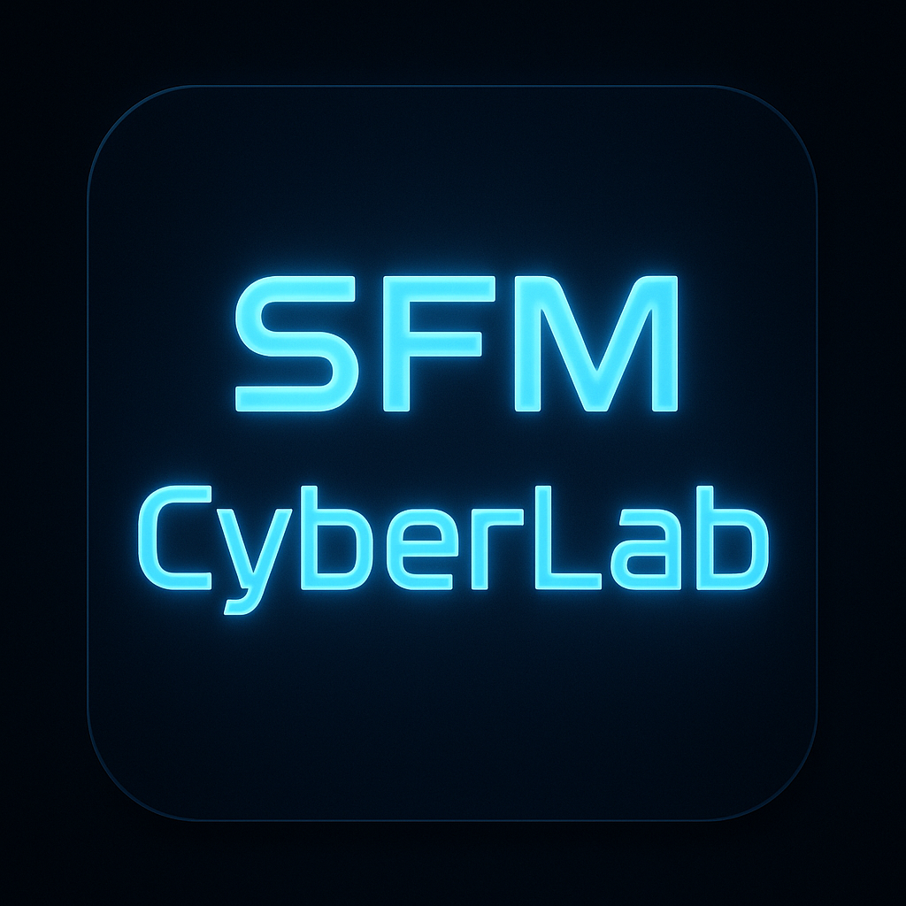
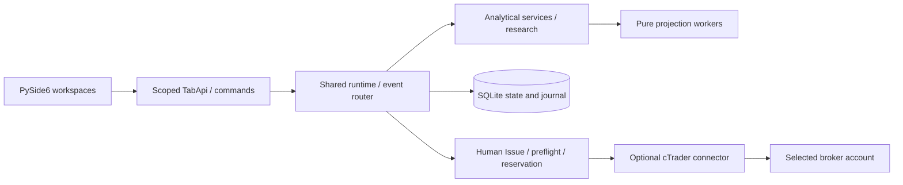

<p align="center"></p>
<h1 align="center">SFM FX New Age</h1>
<p align="center"><strong>A local-first desktop for Forex research, source-aware signals, and deliberate human execution.</strong></p>
<p align="center">
  <a href="CONTRIBUTING.md"></a>
  <a href="LICENSE"></a>
  
  
  
</p>
<p align="center"><a href="#quick-start">Quick start</a> · <a href="docs/README.md">Documentation</a> · <a href="CONTRIBUTING.md">Contribute</a> · <a href="https://github.com/CptAYounes/sfm-fx-new-age/discussions">Discuss</a> · <a href="https://github.com/CptAYounes/sfm-fx-new-age/releases">Releases</a></p>

> **Research software, not a promise of returns.** Historical studies, synthetic fixtures and software tests do not establish a profitable edge or authorize trading. Broker operations can lose money. Start offline; never put credentials or account exports into an issue or pull request.

## What it does

- **Four workspaces:** Chart Engine, Trading Tools, Strategy Research, and signal/operations workflows, backed by **42 stable view contracts**.
- **83 analytical profiles** across six active pairs and W1 / D1 / H4 / H1, with explicit source, trigger, freshness and missing-data states.
- **Interactive charts:** drawings, inspection, source-bound handoffs, replay, a P/L calculator and persisted display preferences.
- **Causal research:** immutable observations, bounded historical studies, training-only walk-forward selection and disclosed model assumptions.
- **One shared core:** typed contracts, scoped tab APIs, a priority event router and SQLite persistence; optional cTrader integration is isolated behind the connector.
- **Deliberate execution:** binding a proposal is local; a separate human **Issue** action and rechecked preflight are required for pending Limit orders. No autonomous entry engine is supplied.

The active pairs are EURUSD, GBPUSD, USDJPY, USDCHF, USDCAD and AUDUSD. NZDUSD is historical-only. Account type is metadata, not an application eligibility gate. The 42 backend identities are not 42 visible user pages: Trading Tools uses dynamic windows.

## Quick start

**Reference environment:** Debian 13 / Linux X11, Python 3.13 and PySide6. Other desktop platforms are not yet qualified. Python 3.14+ must use dependencies with matching wheels; the supplied reference constraints target 3.13 only.

```bash
git clone https://github.com/CptAYounes/sfm-fx-new-age.git
cd sfm-fx-new-age
python3.13 -m venv .venv
source .venv/bin/activate
python -m pip install -c requirements/constraints-py313.txt -e '.[dev]'

# No credentials, network feed or broker action required.
python -m sfm_fx_new_age --check
python -m sfm_fx_new_age --offline-checkpoint
python -m sfm_fx_new_age --fixture-session
```

If Qt libraries are missing, install the OS packages in [Getting started](docs/getting-started.md). The fixture session is **synthetic**, in memory, and never real market data. To open the ordinary unconfigured desktop, use `python -m sfm_fx_new_age`. An existing saved session may reconnect if previously enabled by its owner; use a disposable `--state-dir` for isolated experiments.

For optional cTrader integration:

```bash
python -m pip install -c requirements/constraints-py313.txt -e '.[dev,ctrader]'
```

Bring your own registered cTrader application and human-authorized account. No application secrets, tokens, account records, vendor data captures or private runtime are included. See the [full operator guide](docs/legacy-user-guide.md#saved-application-authorization) before connecting.

## Architecture



Workspaces do not own broker sockets or databases. Pure worker results are source/epoch/version-bound and rechecked before admission. Replays and research cannot issue broker requests. Missing or stale evidence stays unavailable; it is not replaced with fabricated market data.

## Documentation

The complete [engineering library](docs/README.md) includes **60 main documents, 12 architecture decisions, 14 reference chapters and 8 diagrams**, plus source catalogues, traceability and an environment-inventory SBOM.

| Start here | Purpose |
|---|---|
| [Getting started](docs/getting-started.md) | Installation, offline launch, tests and isolated state |
| [Full operator manual](docs/legacy-user-guide.md) | Charts, strategies, source configuration, handoffs and Issue |
| [Architecture description](docs/documents/07-architecture-description.md) | Ownership and runtime boundaries |
| [Extension guide](docs/documents/26-plugins-extensions.md) | Scoped APIs, plugins and tools |
| [Developer guide](docs/development.md) | Code map, tests, contribution boundaries |
| [Engineering handbook: HTML](https://cptayounes.github.io/sfm-fx-new-age/SFM_FX_New_Age_Engineering_Handbook.html) / [PDF](docs/SFM_FX_New_Age_Engineering_Handbook.pdf) | Searchable browser edition and printable handbook |
| [Public-edition provenance](docs/publication.md) | Included files, privacy exclusions and historical-evidence limits |
| [Security policy](SECURITY.md) | Private vulnerability reporting and sensitive-data rules |

The HTML/PDF files can also be downloaded and read offline. Historical release receipts describe the original private qualification environment; they are not new public-clone measurements or a current market certification.

## Development

```bash
python -m pip install -c requirements/constraints-py313.txt -e '.[dev,ctrader]'
QT_QPA_PLATFORM=offscreen python -m pytest tests -q
python scripts/verify_publication.py
python -m build
```

The initial public copy passed **1,541 offline tests**, with no failures/errors/skips. A [GitHub Actions template](.github/ci-template.yml) is included but **not active**: the maintainer's saved GitHub authorization currently lacks `workflow` permission. See [activation instructions](docs/development.md#activating-github-actions); the badge above reports the verified local publication run, not a hosted CI run.

See [CONTRIBUTING.md](CONTRIBUTING.md) for review expectations and [open issues](https://github.com/CptAYounes/sfm-fx-new-age/issues) for improvements. Good contributions include reproducibility, portability, accessibility, source correctness, performance evidence and small, tested extensions. Please distinguish implemented behavior, proposed features and unverified trading hypotheses.

## Status and limits

This is the **0.2.0 initial public source release**, not a production trading guarantee. Price-based studies do not reconstruct unknown ticks, execution order or broker costs. Optional provider entitlement, autonomous exits, broker-side stop protection, a consolidated FX full book and profitability certification are not supplied. Tests use labelled synthetic data unless explicitly stated otherwise. Connected verification scripts are operator tools, not routine CI commands.

[PROGRESS.md](PROGRESS.md) retains the sanitized engineering history and remains the single project progress diary. The original local runtime and sealed private receipts are intentionally not distributed.

## License

**MIT © 2026 Anthony Younes.** Use, modify, fork, redistribute, sublicense or sell the original software and documentation, including in commercial or closed-source projects, subject to retaining the MIT notice. Contributions are welcome; sharing changes back is appreciated, not required by the license. Third-party packages, provider data and trademarks keep their own terms; see [NOTICE](NOTICE).
