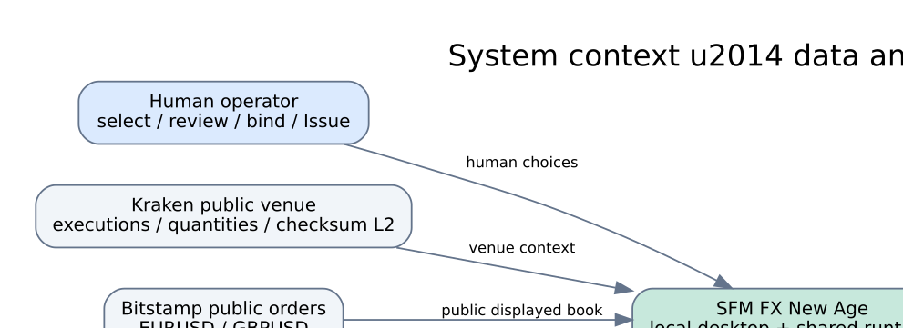
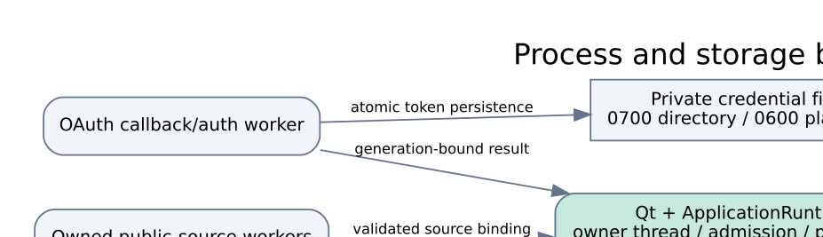
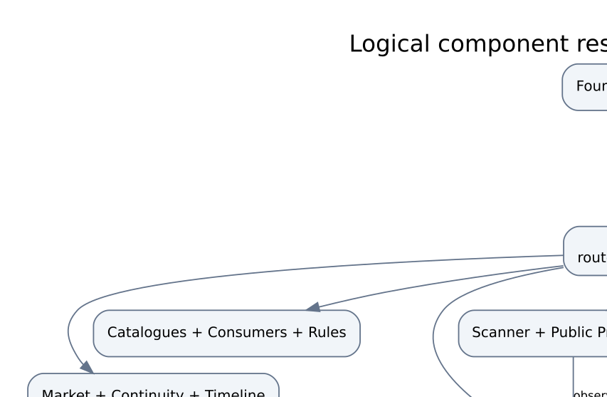
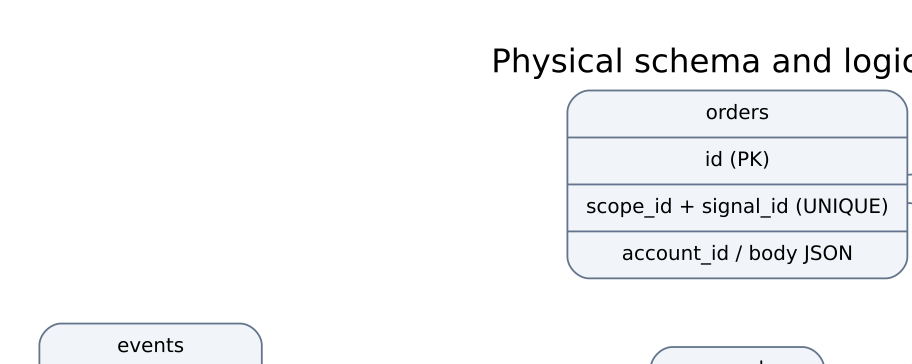
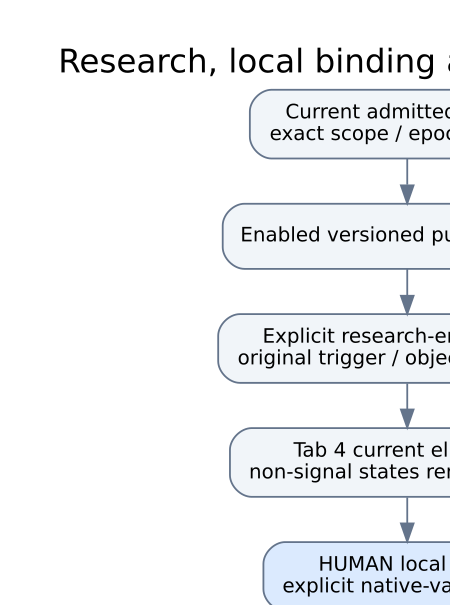
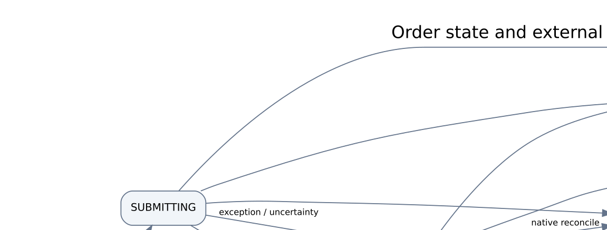
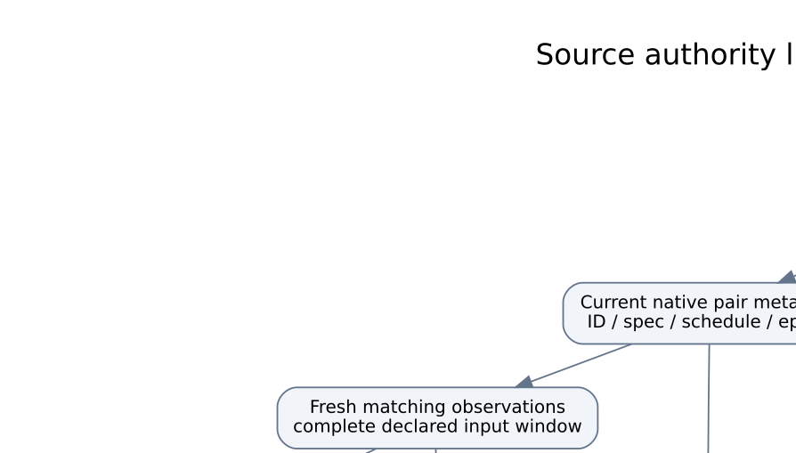
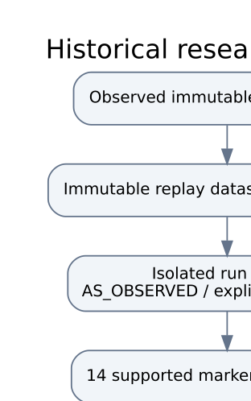

# Architecture Diagram Atlas

Logical diagrams describe the inspected application, not cloud deployment or a claim of standards certification. Dashed associations are labelled conceptual links, not invented SQL foreign keys. The order-state summary omits self-loops; OrderService is authoritative.

## System context — data and deliberate action

[Editable Graphviz](01-system-context.dot) · [PNG](01-system-context.png)

## Process and storage boundaries

[Editable Graphviz](02-process-ownership.dot) · [PNG](02-process-ownership.png)

## Logical component responsibilities

[Editable Graphviz](03-components.dot) · [PNG](03-components.png)

## Physical schema and logical associations

[Editable Graphviz](04-data-model.dot) · [PNG](04-data-model.png)

## Research, local binding and separate Issue

[Editable Graphviz](05-research-to-issue.dot) · [PNG](05-research-to-issue.png)

## Order state and external uncertainty

[Editable Graphviz](06-order-uncertainty.dot) · [PNG](06-order-uncertainty.png)

## Source authority lifecycle

[Editable Graphviz](07-source-lifecycle.dot) · [PNG](07-source-lifecycle.png)

## Historical research isolation

[Editable Graphviz](08-replay-isolation.dot) · [PNG](08-replay-isolation.png)
